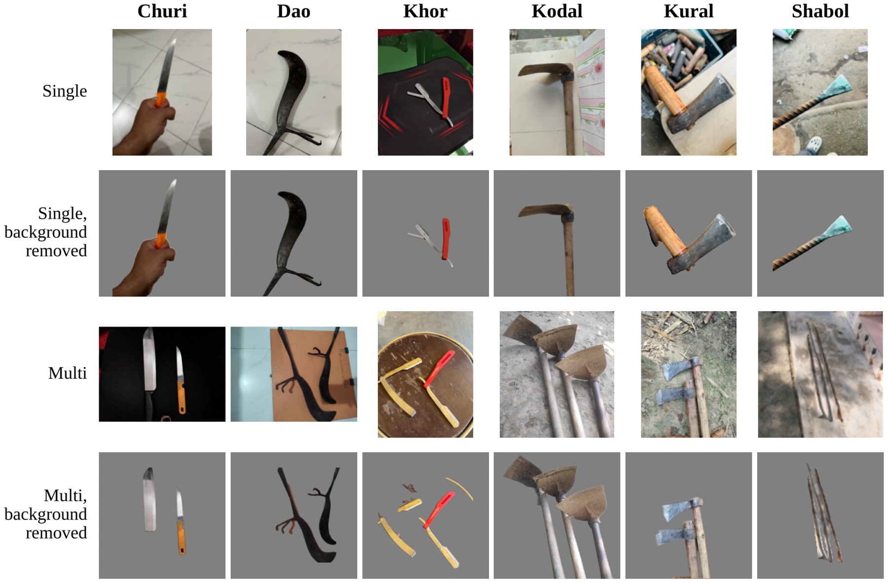

# BD-LW: An Image Dataset and Multi-Criteria Benchmark for Local Weapon Recognition in Bangladesh

> **Status:** this repository accompanies a manuscript currently **under review** at *Multimedia Tools and Applications*. It is shared so that reviewers and editors can access the dataset and check the results. The citation will be added after publication.

BD-LW is an image dataset of six traditional Bangladeshi implements that are used as weapons in local violence. This repository contains the notebooks that build the dataset split, train and evaluate all models, and produce every table and figure in the manuscript.

**Dataset (Mendeley Data):** [https://doi.org/10.17632/2ns343t8xg.1](https://doi.org/10.17632/2ns343t8xg.1)
**Manuscript:** "BD-LW: An Image Dataset and Multi-Criteria Benchmark for Local Weapon Recognition in Bangladesh", submitted to *Multimedia Tools and Applications*

## For reviewers

- **Dataset:** download it from Mendeley Data: [https://doi.org/10.17632/2ns343t8xg.1](https://doi.org/10.17632/2ns343t8xg.1).
- **Fixed split:** the Mendeley archive holds all 3,075 original photographs. `splits/manifest.csv` lists the 2,950 images of the benchmark (column `source_file` gives the original file), with the exact test set and cross-validation folds; `splits/removed_duplicates.csv` lists the 125 near-duplicates that were removed. Stage 0 reproduces this curation from the original photographs.
- **Results:** every table in the manuscript can be traced to a notebook (see the table below), and the CSV files behind the tables are in `results/`.
- **Supplementary material:** `docs/supplementary_material.pdf` (also submitted to the journal) lists which notebook produces each result in Section S4.

---

## Dataset at a glance

The Mendeley archive contains all **3,075** original photographs. Removing 125 near-duplicates leaves the **2,950** images used as the benchmark in the manuscript (listed in `splits/manifest.csv`).

| Class | Local name | English | Original photos | Benchmark images |
|---|---|---|---|---|
| 0 | Churi | Knife | 530 | 521 |
| 1 | Dao | Machete | 533 | 530 |
| 2 | Khor | Straight razor | 536 | 471 |
| 3 | Kodal | Hoe | 482 | 477 |
| 4 | Kural | Axe | 486 | 477 |
| 5 | Shabol | Iron crowbar | 508 | 474 |
| | | **Total** | **3,075** | **2,950** |

| Subset | Original photos | Benchmark images |
|---|---|---|
| Single (one weapon per image) | 1,849 | 1,776 |
| Multi (several weapons of the same class) | 1,226 | 1,174 |

- **Capture sources (benchmark):** iPhone 14 (1,119), Redmi Note 15 (647), Samsung Galaxy M14 (538), WhatsApp-shared (646)
- **Fixed split:** a locked test set of 419 images and five cross-validation folds, built so that near-identical photos never cross the split

<p align="center">
  
</p>

---

## Repository structure

```
BD-Local-Weapon-Classification/
├── BD Local Weapon Notebooks/
│   ├── stage0-single-multi-3parts.ipynb
│   ├── nb1-background-removal.ipynb
│   ├── nb2-training-scenarios.ipynb
│   ├── nb3-analysis-scenarios.ipynb
│   ├── nb4-paper-figures.ipynb
│   ├── nb5-gradcam-architecture.ipynb
│   ├── nb6-ablation-check.ipynb
│   ├── nb7-no-weapon.ipynb
│   ├── nb8-annotation-validation.ipynb
│   ├── nb9-robustness-5fold.ipynb
│   ├── nb10-gradcam-all-models.ipynb
│   ├── nb11-clip-timing-checkpoints.ipynb
│   ├── nb12-merge-and-statistics.ipynb
│   └── nb13-misclassified-test-images.ipynb
├── splits/
│   ├── manifest.csv          # the 2,950 benchmark images: original file, class, subset, capture source, split, fold, group
│   ├── removed_duplicates.csv# the 125 near-duplicates removed from the 3,075 original photos
│   ├── class_map.json
│   ├── test.txt              # image IDs of the locked test set (419)
│   └── fold0.txt … fold4.txt # image IDs of each cross-validation fold
├── results/                  # CSV files behind the tables (see results/README.md)
│   ├── tables/               # main analysis (Notebook 3)
│   ├── gradcam_scenarios/    # Notebook 5
│   ├── ablation_check/       # Notebook 6
│   ├── no_weapon/            # Notebook 7
│   ├── annotation_validation/# Notebook 8
│   └── revision/             # Notebooks 9 to 13
├── docs/
│   └── supplementary_material.pdf
├── assets/
│   └── sample_images.png
├── requirements.txt
├── LICENSE
└── README.md
```

---

## Notebooks

All notebooks were run on Kaggle with one Tesla T4 GPU. Run them in the order below; each one reads the outputs of the earlier ones, which are attached on Kaggle with **Add Input > Your Work**. The first cell of every notebook lists its inputs.

| Notebook | What it does | GPU |
|---|---|---|
| [Stage 0: data curation](BD%20Local%20Weapon%20Notebooks/stage0-single-multi-3parts.ipynb) | Standardizes images, removes near-duplicates, builds similarity groups and the fixed split (test set and five folds) | No |
| [1: Background removal](BD%20Local%20Weapon%20Notebooks/nb1-background-removal.ipynb) | Weapon masks and cut-outs with IS-Net | Yes |
| [2: Training](BD%20Local%20Weapon%20Notebooks/nb2-training-scenarios.ipynb) | Trains all models and preprocessing pipelines in three scenarios (all, single, multi) | Yes |
| [3: Analysis](BD%20Local%20Weapon%20Notebooks/nb3-analysis-scenarios.ipynb) | Statistics, transfer, robustness, calibration, capture-source test, cost | Yes |
| [4: Paper figures](BD%20Local%20Weapon%20Notebooks/nb4-paper-figures.ipynb) | Figures for the manuscript | No |
| [5: Grad-CAM across scenarios](BD%20Local%20Weapon%20Notebooks/nb5-gradcam-architecture.ipynb) | Grad-CAM of ConvNeXt-Tiny and ViT-S/16 for three pipelines and scenarios | Yes |
| [6: Ablation check](BD%20Local%20Weapon%20Notebooks/nb6-ablation-check.ipynb) | Repeats key ablations with ConvNeXt-Tiny and ViT-S/16 | Yes |
| [7: Images without weapons](BD%20Local%20Weapon%20Notebooks/nb7-no-weapon.ipynb) | False alarms on 112 non-weapon images | Yes |
| [8: Annotation validation](BD%20Local%20Weapon%20Notebooks/nb8-annotation-validation.ipynb) | Second-annotator agreement (Cohen's kappa) | No |
| [9: Robustness, 5 folds](BD%20Local%20Weapon%20Notebooks/nb9-robustness-5fold.ipynb) | Six corruptions at five levels for all fold models | Yes |
| [10: Grad-CAM, all models](BD%20Local%20Weapon%20Notebooks/nb10-gradcam-all-models.ipynb) | Attention on the weapon, chance baselines, ViT attention rollout | Yes |
| [11: Zero-shot CLIP](BD%20Local%20Weapon%20Notebooks/nb11-clip-timing-checkpoints.ipynb) | CLIP baseline without training; checkpoint names | Yes |
| [12: Merge and statistics](BD%20Local%20Weapon%20Notebooks/nb12-merge-and-statistics.ipynb) | Combines 9 to 11, corrected CV statistics, group sizes | No |
| [13: Misclassified images](BD%20Local%20Weapon%20Notebooks/nb13-misclassified-test-images.ipynb) | Every misclassified test image | No |

---

## Main results

| Model | Test macro-F1 (E1) | Mean macro-F1 under corruption | CPU time / image |
|---|---|---|---|
| ResNet-50 | 0.998 | 0.919 | 164 ms |
| EfficientNet-B0 | 1.000 | 0.787 | 56 ms |
| ConvNeXt-Tiny | 0.998 | 0.918 | 153 ms |
| ViT-S/16 | 1.000 | 0.965 | 181 ms |
| DINOv2 + logistic regression | 0.985 | n/a | 77 ms |

Clean accuracy is near perfect, but models trained on one image type fall to 0.54 to 0.86 on the other, and a model trained on one phone falls to 0.534 on the others. See the manuscript for details.

---

## Quick start

1. Download the dataset from [Mendeley Data](https://doi.org/10.17632/2ns343t8xg.1) and upload it to Kaggle as a private dataset.
2. Open `stage0-single-multi-3parts.ipynb` on Kaggle, add the dataset as input and run all cells.
3. Continue with the notebooks in the order above.

To use the dataset with the official split, read `splits/manifest.csv`: train on the images whose `split` is not `"test"` (use the `fold` column for cross-validation) and report results on `split == "test"` (419 images).

### Requirements

```
pip install -r requirements.txt
```

Main packages: Python 3.10+, PyTorch 2.x, timm 1.0, scikit-learn, OpenCV, pandas, matplotlib, open_clip_torch (Notebook 11 only).

---

## Citation

The manuscript is under review; its citation will be added here after publication. Until then, please cite the dataset:

```
Sarker, A., Khan, J. U., Rahman, A., Rasheduzzaman, Md. (2026). BD-LW: An Image Dataset of
Bangladeshi Local Weapons. Mendeley Data, V1.
https://doi.org/10.17632/2ns343t8xg.1
```

---

## License

- **Code:** MIT License (see `LICENSE`)
- **Dataset:** CC BY-NC 4.0, for research use only. It must not be used for automated surveillance or profiling of people. During the review period, please do not redistribute it.

## Contact

[Aminur Rahman], [aminur.cse@diu.ac]
